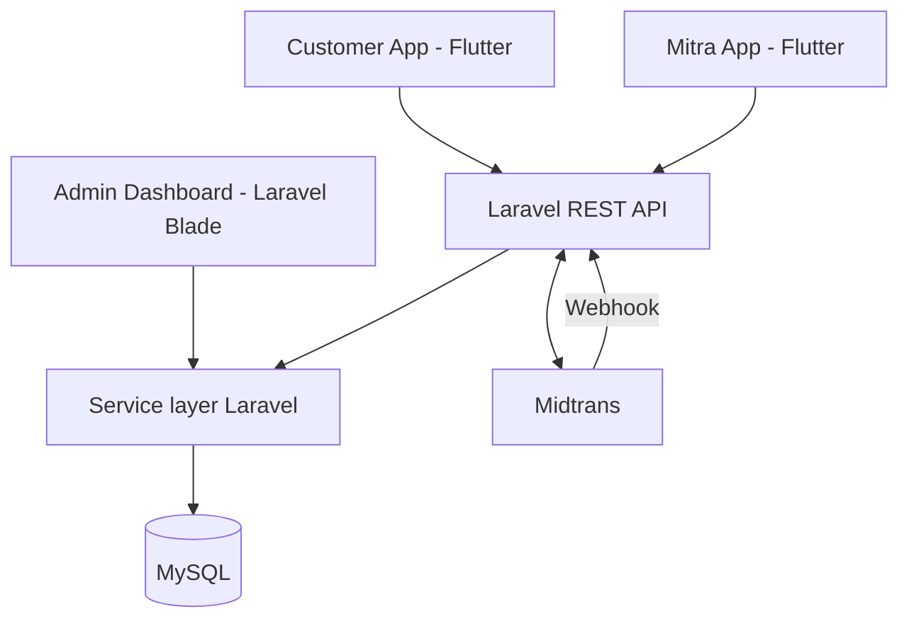

# Marketplace Jasa Rumahan

Aplikasi marketplace yang menghubungkan customer dengan mitra penyedia jasa rumah tangga (Home Cleaning, Lawn Mowing, Tree Trimming, dll). Customer memilih jasa, ukuran properti, add-on, dan jadwal; sistem mencarikan mitra yang sesuai dan tersedia.

Proyek akhir mata kuliah **Mobile Programming II (0696)**, Program Studi Sistem Informasi, Universitas BSI.

> **Status (11 Nov 2026):** backend P1-P4a selesai dan dites (55 tes hijau). Sisa backend: expiry pembayaran + auto-complete (P4c), Admin Blade (P5), Midtrans (P4b), hardening (P6). Aplikasi Flutter belum dimulai. Detail dan langkah berikutnya: [`docs/PROGRESS.md`](docs/PROGRESS.md) dan [`docs/PLAN_LANJUTAN.md`](docs/PLAN_LANJUTAN.md).
>
> Repo: https://github.com/NielTur/jasa-rumahan (Private).

## Fitur MVP

- Customer bisa masuk sebagai **guest** tanpa login, atau mendaftar dan login dengan nomor telepon.
- Katalog jasa, harga per ukuran properti, dan add-on. Harga dihitung ulang di server.
- Pilih tanggal dan slot waktu; pengecekan bentrok jadwal.
- Pencarian mitra bertahap dengan batas percobaan.
- Mitra memilih jasa yang ditawarkan, mengatur jadwal, menerima/menolak pesanan, dan memperbarui progres pengerjaan.
- Pembayaran lewat **Midtrans (Sandbox)**, diverifikasi backend lewat webhook.
- Tracking status dan konfirmasi selesai oleh customer.
- Admin Dashboard (Laravel Blade): akun, katalog, harga, pesanan, transaksi.

Di luar MVP: COD, komplain, rating, verifikasi mitra lengkap, saldo/pencairan, push notification, live chat, GPS tracking, voucher. Rincian di dokumen desain §16.

## Arsitektur



Dua aplikasi Flutter berkomunikasi dengan backend lewat REST API (Dio). Admin Dashboard memakai service layer yang sama dengan API, tanpa memanggil API sendiri.

## Struktur repo

```
jasa-rumahan/
├── README.md
├── AI_RULES.md              # satu-satunya salinan aturan AI
├── CLAUDE.md                # pointer ke AI_RULES.md
├── AGENTS.md                # pointer ke AI_RULES.md
├── scripts/
│   ├── bundle-chatgpt.ps1   # gabung dokumen jadi 3 file untuk ChatGPT
│   └── dump-code.ps1        # gabung kode backend jadi 1 file (KODE_BACKEND.txt) untuk dilampirkan ke chat
├── docs/
│   ├── Dokumentasi_Sistem_Marketplace_Jasa_Rumahan.md   # desain sistem + 16 tabel
│   ├── API_CONTRACT.md      # kesepakatan Flutter <-> Laravel
│   ├── DECISIONS.md         # keputusan, celah desain, pertanyaan terbuka
│   ├── PROGRESS.md          # catatan serah-terima antar sesi
│   ├── PLAN_LANJUTAN.md     # rencana kerja berikutnya (T0-T7)
│   ├── PROMPTS.md           # prompt kerja bersama AI
│   └── postman/             # collection Postman (diisi di P6)
├── backend/                 # Laravel: REST API + Admin Blade
├── packages/core/           # Flutter (BELUM ADA): model, helpers (api_client, user_info)
└── apps/                    # Flutter (BELUM ADA)
    ├── customer_app/        # lib/ui, lib/service
    └── mitra_app/           # lib/ui, lib/service
```

Struktur folder Flutter mengikuti modul kuliah: `ui`, `model`, `service`, `helpers`.

## Prasyarat

Versi yang dipakai saat pengembangan (dari output perintah, lihat juga `docs/PROGRESS.md`).

| Alat | Versi |
|---|---|
| PHP | 8.3.32 |
| Composer | 2.11.1 |
| Laravel / Sanctum | 10.50.4 / 3.3.3 |
| MySQL | 8.0.30 (Laragon) |
| Flutter / Dart | 3.41.6 / 3.11.4 |
| Android Studio / emulator | `<isi saat Flutter dimulai>` |

Lingkungan pengembangan: Windows + Laragon + VS Code + PowerShell. Laravel 10 sudah EOL, jadi proyek ini hanya untuk demo lokal dan Sandbox, jangan di-deploy publik (DECISIONS CR-08).

## Mulai cepat

### Backend

```powershell
cd backend
composer install
copy .env.example .env
php artisan key:generate
# buat database kosong jasa_rumahan, lalu isi DB_* di .env
php artisan migrate:fresh --seed
php artisan serve --host=0.0.0.0 --port=8000
```

`APP_KEY` di `.env.example` sengaja **kosong**; `key:generate` mengisinya di `.env` milik masing-masing orang. Jangan pernah commit `.env`.

Di terminal lain, agar kedaluwarsa tawaran dan pembayaran terproses:

```bash
php artisan schedule:work
```

### Aplikasi Flutter (belum dibuat)

Bagian ini berlaku setelah Flutter dimulai.

```bash
cd apps/customer_app    # atau apps/mitra_app
flutter pub get
flutter run --dart-define=API_BASE_URL=http://10.0.2.2:8000/api
```

- `10.0.2.2` adalah alamat laptop dari dalam emulator Android. Untuk HP fisik, pakai IP LAN laptop (`http://192.168.x.x:8000/api`) atau URL tunnel.
- Mode tanpa backend (data mock dari `assets/mock/`): tambahkan `--dart-define=USE_MOCK=true`.

### Akun demo

Dibuat oleh `php artisan migrate:fresh --seed`. Password semua akun: `password123` (hanya data demo).

| Role | Telepon |
|---|---|
| Admin | `081200000001` |
| Customer | `081200000011`, `081200000012` |
| Mitra (approved) | `081200000021`, `081200000022`, `081200000023` |

Admin ditolak login lewat API; akun admin dipakai untuk dashboard Blade (P5).

## Konfigurasi (`backend/.env`)

| Variabel | Fungsi | Default usulan |
|---|---|---|
| `APP_TIMEZONE` | Zona waktu | `Asia/Jakarta` |
| `MIDTRANS_SERVER_KEY`, `MIDTRANS_CLIENT_KEY` | Kunci Sandbox (jangan di-commit) | dari dashboard Midtrans |
| `MIDTRANS_IS_PRODUCTION` | Mode | `false` |
| `MITRA_RESPONSE_SECONDS` | Batas respons mitra | `180` |
| `MAX_MITRA_ATTEMPTS` | Maks mitra yang ditawari | `3` |
| `PAYMENT_EXPIRY_MINUTES` | Batas bayar setelah mitra accept | `30` |
| `AUTO_COMPLETE_HOURS` | Auto-selesai jika customer tidak konfirmasi | `24` |
| `MIN_LEAD_MINUTES` | Jarak minimum slot dari sekarang | `60` |
| `MITRA_AUTO_APPROVE` | Mitra baru langsung aktif | `true` (dev/demo) |
| `APP_ENV` | `local` mengaktifkan `POST /dev/orders/{kode}/simulate-paid`. **Jangan `local` di server publik** | `local` (dev) |

Nilai default dan alasannya ada di [`docs/DECISIONS.md`](docs/DECISIONS.md).

## Pembayaran (Midtrans Sandbox)

> **Belum diimplementasi (P4b).** Akun Sandbox belum dibuat; paket `midtrans/midtrans-php` dipasang di awal P4b. Sementara itu, untuk menguji alur mitra tanpa Midtrans, pakai `POST /dev/orders/{kode}/simulate-paid` (hanya `APP_ENV=local`). Itu alat dev, **bukan** pengganti Midtrans: dosen mensyaratkan minimal satu API eksternal.

Rencana untuk P4b:

1. Isi kunci Sandbox di `.env`.
2. Webhook Midtrans butuh URL publik. Jalankan tunnel, mis. `ngrok http 8000`, lalu isi **Payment Notification URL** di dashboard Sandbox dengan `https://<tunnel>/api/webhooks/midtrans`.
3. Tanpa tunnel, status pembayaran tetap bisa diperiksa lewat endpoint `GET /api/orders/{kode}/payment` yang menanyakan Midtrans Status API.
4. Uji pembayaran dengan Payment Simulator Midtrans Sandbox.

Status pembayaran hanya dipercaya dari webhook yang lolos verifikasi signature atau dari Status API. Redirect dari halaman pembayaran bukan bukti bayar.

## Dokumentasi

| Dokumen | Isi |
|---|---|
| [Dokumentasi sistem](docs/Dokumentasi_Sistem_Marketplace_Jasa_Rumahan.md) | Alur bisnis, role, 16 tabel, ERD |
| [API Contract](docs/API_CONTRACT.md) | Endpoint, format, status, mapping Midtrans |
| [Decisions](docs/DECISIONS.md) | Parameter, celah desain, pertanyaan terbuka |
| [Progress](docs/PROGRESS.md) | Kondisi terkini proyek, branch, riwayat sesi |
| [Plan Lanjutan](docs/PLAN_LANJUTAN.md) | Rencana kerja berikutnya (T0-T7) |
| [Prompts](docs/PROMPTS.md) | Prompt kerja dengan AI |
| [AI Rules](AI_RULES.md) | Aturan untuk AI asisten (`CLAUDE.md` dan `AGENTS.md` hanya pointer) |
| Bundel ChatGPT | 3 file gabungan hasil `scripts/bundle-chatgpt.ps1` (lihat `docs/PROMPTS.md` §G). Folder `chatgpt-bundle/` di-gitignore |

## Pengujian

Tes memakai database MySQL **terpisah** supaya data demo aman. Buat sekali (HeidiSQL atau klien MySQL Laragon):

```sql
CREATE DATABASE jasa_rumahan_test CHARACTER SET utf8mb4 COLLATE utf8mb4_unicode_ci;
```

Kredensial MySQL diambil dari `.env`; `phpunit.xml` memaksa nama database ke `jasa_rumahan_test`. Lalu:

```powershell
cd backend
php artisan test
```

Hasil terakhir: **55 tes lulus, 239 assertion** (P3a-P4a). Tes untuk P1/P2 menyusul (tes catch-up, target 89 tes). Tes yang masih wajib: webhook (signature salah, duplikat, out-of-order, amount beda) di P4b, dan bukti race `dev:race-accept` di P6. Uji manual alur lengkap memakai Postman collection di `docs/postman/` (diisi di P6).

## Alur kerja tim dan AI

- Satu tugas = satu branch `feat/<area>-<ringkas>`; commit kecil; tidak commit `.env`.
- Setiap tahap hijau langsung di-push ke GitHub (Git-5). Branch ditumpuk; review dilakukan sekali di branch teratas lalu merge ke `main`.
- Pengembangan dibantu dua AI dengan pembagian area dan review silang; lihat [`AI_RULES.md`](AI_RULES.md) dan [`docs/PROMPTS.md`](docs/PROMPTS.md). Urutan kerja: backend dulu (Claude), Flutter setelahnya (ChatGPT).
- Merge ke `main` setelah: jalan di emulator/Postman, tes backend hijau, direview, dan disetujui anggota tim.

## Jadwal dan luaran

Dipatok ke nomor pertemuan karena tanggal pasti belum diketahui. Per 10 Nov 2026 proyek ada di sekitar pertemuan 8.

| Pertemuan | Fokus | Hasil |
|---|---|---|
| 8-9 | Tes catch-up, P4c, P5 Admin; mulai Flutter | Backend hampir lengkap; checkpoint Flutter akhir pertemuan 9 (usulan): login + katalog + buat pesanan jalan |
| 10-11 | P4b Midtrans, Flutter alur customer dan mitra | Bayar Sandbox ujung ke ujung |
| 12 | P6 Hardening, **feature freeze** (usulan) | Race test, Postman collection, review, merge, kontrak v1.0 |
| 13 | **Presentasi** (dari dosen) | Demo + Manual Book |

**Luaran akhir: Manual Book saja** (panduan cara memakai aplikasi per role). Tanpa laporan akhir, poster, atau karya tulis ilmiah. Video hanya jika pertemuan 13 ternyata bukan presentasi. Syarat dari dosen: minimal satu API eksternal (Midtrans). Rincian: `docs/DECISIONS.md` §3 dan §4.

## Tim

| Nama | Peran |
|---|---|
| `<isi>` | `<backend / customer app / mitra app / admin / Manual Book>` |

Dosen pengampu: Ade Hendini, M.Kom.
