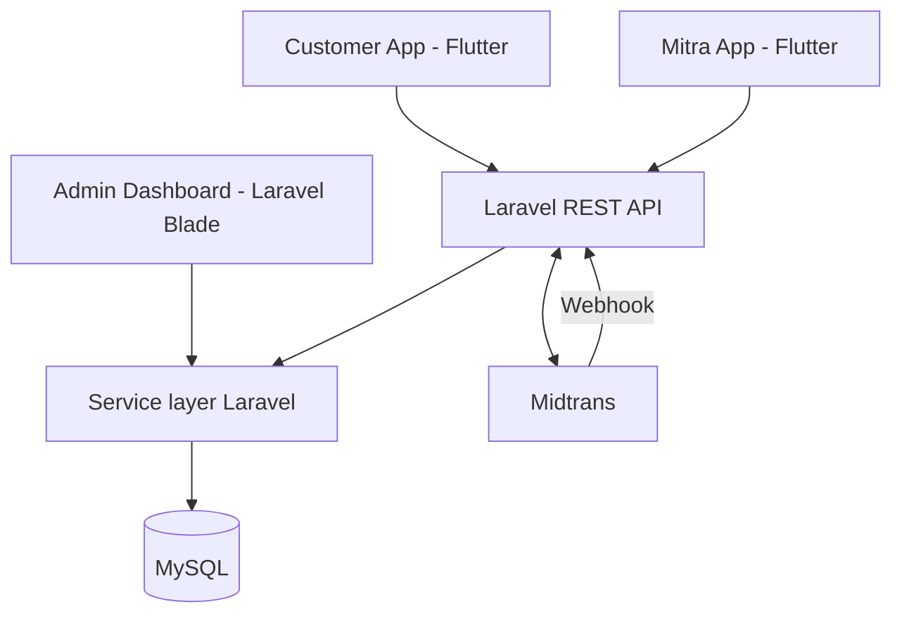

# Marketplace Jasa Rumahan

Aplikasi marketplace yang menghubungkan customer dengan mitra penyedia jasa rumah tangga (Home Cleaning, Lawn Mowing, Tree Trimming, dll). Customer memilih jasa, ukuran properti, add-on, dan jadwal; sistem mencarikan mitra yang sesuai dan tersedia.

Proyek akhir mata kuliah **Mobile Programming II (0696)**, Program Studi Sistem Informasi, Universitas BSI.

> **Status:** dalam pengembangan. Fase aktif tercatat di [`docs/PROGRESS.md`](docs/PROGRESS.md).

## Fitur MVP

- Customer bisa masuk sebagai **guest** tanpa login, atau mendaftar dan login dengan nomor telepon.
- Katalog jasa, harga per ukuran properti, dan add-on. Harga dihitung ulang di server.
- Pilih tanggal dan slot waktu; pengecekan bentrok jadwal.
- Pencarian mitra bertahap dengan batas percobaan.
- Mitra memilih jasa yang ditawarkan, mengatur jadwal, menerima/menolak pesanan, dan memperbarui progres pengerjaan.
- Pembayaran lewat **Midtrans (Sandbox)**, diverifikasi backend lewat webhook.
- Tracking status dan konfirmasi selesai oleh customer.
- Admin Dashboard (Laravel Blade): akun, katalog, harga, pesanan, transaksi.

Di luar MVP: COD, komplain, rating, verifikasi mitra lengkap, saldo/pencairan, push notification, live chat, GPS tracking, voucher. Rincian di dokumen desain §16.

## Arsitektur



Dua aplikasi Flutter berkomunikasi dengan backend lewat REST API (Dio). Admin Dashboard memakai service layer yang sama dengan API, tanpa memanggil API sendiri.

## Struktur repo

```
jasa-rumahan/
├── README.md
├── AI_RULES.md              # salin juga sebagai CLAUDE.md dan AGENTS.md
├── docs/
│   ├── Dokumentasi_Sistem_Marketplace_Jasa_Rumahan.md   # desain sistem + 16 tabel
│   ├── API_CONTRACT.md      # kesepakatan Flutter <-> Laravel
│   ├── DECISIONS.md         # keputusan, celah desain, pertanyaan terbuka
│   ├── PROGRESS.md          # catatan serah-terima antar sesi
│   └── PROMPTS.md           # prompt kerja bersama AI
├── backend/                 # Laravel: REST API + Admin Blade
├── packages/core/           # Flutter package: model, helpers (api_client, user_info)
└── apps/
    ├── customer_app/        # Flutter: lib/ui, lib/service
    └── mitra_app/           # Flutter: lib/ui, lib/service
```

Struktur folder Flutter mengikuti modul kuliah: `ui`, `model`, `service`, `helpers`.

## Prasyarat

Isi versi dari output perintah masing-masing (lihat juga `docs/PROGRESS.md`).

| Alat | Versi |
|---|---|
| PHP + Composer | `<php -v>` |
| Laravel | `<composer show laravel/framework>` |
| MySQL | `<versi>` |
| Flutter | `<flutter --version>` |
| Android Studio / emulator | `<versi>` |

## Mulai cepat

### Backend

```bash
cd backend
composer install
cp .env.example .env
php artisan key:generate
# buat database kosong, lalu isi DB_* di .env
php artisan migrate:fresh --seed
php artisan serve --host=0.0.0.0 --port=8000
```

Di terminal lain, agar kedaluwarsa tawaran dan pembayaran terproses:

```bash
php artisan schedule:work
```

### Aplikasi Flutter

```bash
cd apps/customer_app    # atau apps/mitra_app
flutter pub get
flutter run --dart-define=API_BASE_URL=http://10.0.2.2:8000/api
```

- `10.0.2.2` adalah alamat laptop dari dalam emulator Android. Untuk HP fisik, pakai IP LAN laptop (`http://192.168.x.x:8000/api`) atau URL tunnel.
- Mode tanpa backend (data mock dari `assets/mock/`): tambahkan `--dart-define=USE_MOCK=true`.

### Akun demo

Dibuat oleh seeder (isi setelah Fase P0):

| Role | Telepon | Password |
|---|---|---|
| Admin | `<isi>` | `<isi>` |
| Customer | `<isi>` | `<isi>` |
| Mitra | `<isi>` | `<isi>` |

## Konfigurasi (`backend/.env`)

| Variabel | Fungsi | Default usulan |
|---|---|---|
| `APP_TIMEZONE` | Zona waktu | `Asia/Jakarta` |
| `MIDTRANS_SERVER_KEY`, `MIDTRANS_CLIENT_KEY` | Kunci Sandbox (jangan di-commit) | dari dashboard Midtrans |
| `MIDTRANS_IS_PRODUCTION` | Mode | `false` |
| `MITRA_RESPONSE_SECONDS` | Batas respons mitra | `180` |
| `MAX_MITRA_ATTEMPTS` | Maks mitra yang ditawari | `3` |
| `PAYMENT_EXPIRY_MINUTES` | Batas bayar setelah mitra accept | `30` |
| `AUTO_COMPLETE_HOURS` | Auto-selesai jika customer tidak konfirmasi | `24` |
| `MIN_LEAD_MINUTES` | Jarak minimum slot dari sekarang | `60` |
| `MITRA_AUTO_APPROVE` | Mitra baru langsung aktif | `true` (dev/demo) |

Nilai default dan alasannya ada di [`docs/DECISIONS.md`](docs/DECISIONS.md).

## Pembayaran (Midtrans Sandbox)

1. Isi kunci Sandbox di `.env`.
2. Webhook Midtrans butuh URL publik. Jalankan tunnel, mis. `ngrok http 8000`, lalu isi **Payment Notification URL** di dashboard Sandbox dengan `https://<tunnel>/api/webhooks/midtrans`.
3. Tanpa tunnel, status pembayaran tetap bisa diperiksa lewat endpoint `GET /api/orders/{kode}/payment` yang menanyakan Midtrans Status API.
4. Uji pembayaran dengan Payment Simulator Midtrans Sandbox.

Status pembayaran hanya dipercaya dari webhook yang lolos verifikasi signature atau dari Status API. Redirect dari halaman pembayaran bukan bukti bayar.

## Dokumentasi

| Dokumen | Isi |
|---|---|
| [Dokumentasi sistem](docs/Dokumentasi_Sistem_Marketplace_Jasa_Rumahan.md) | Alur bisnis, role, 16 tabel, ERD |
| [API Contract](docs/API_CONTRACT.md) | Endpoint, format, status, mapping Midtrans |
| [Decisions](docs/DECISIONS.md) | Parameter, celah desain, pertanyaan terbuka |
| [Progress](docs/PROGRESS.md) | Kondisi terkini proyek |
| [Prompts](docs/PROMPTS.md) | Prompt kerja dengan AI |
| [AI Rules](AI_RULES.md) | Aturan untuk AI asisten |

## Pengujian

```bash
cd backend && php artisan test
```

Tes yang wajib ada: kalkulasi harga, bentrok jadwal, transisi status, accept bersamaan, webhook (signature salah, duplikat, out-of-order), guest tracking. Uji manual alur lengkap memakai Postman collection di `docs/postman/` (diisi di P6).

## Alur kerja tim dan AI

- Satu tugas = satu branch `feat/<area>-<ringkas>`; commit kecil; tidak commit `.env`.
- Pengembangan dibantu dua AI dengan pembagian area dan review silang; lihat [`AI_RULES.md`](AI_RULES.md) dan [`docs/PROMPTS.md`](docs/PROMPTS.md).
- Merge ke `main` setelah: jalan di emulator/Postman, tes backend hijau, direview, dan disetujui anggota tim.

## Roadmap 4 minggu

Asumsi mulai Senin 9 Nov 2026. Sesuaikan dengan deadline dosen (pertemuan 14 dan 15).

| Minggu | Fokus | Hasil |
|---|---|---|
| Pra (7-8 Nov) | P0 Fondasi + jawaban Q-1..Q-7 | Repo jalan di semua laptop, kontrak v1.0 |
| 1 (9-15 Nov) | P1 Auth & Katalog | Login + katalog + harga tampil |
| 2 (16-22 Nov) | P2 Pemesanan + P3 Alur Mitra | Buat order → mitra accept → progres status |
| 3 (23-29 Nov) | P4 Pembayaran + P5 Admin → **feature freeze** | Bayar sandbox, admin kelola harga |
| 4 (30 Nov-6 Des) | P6 Hardening, demo, luaran | APK, dokumen, video, poster, KTI, presentasi |

**Jalur paralel sejak minggu 1** (oleh anggota non-coding / bergiliran): rekam proses desain untuk video, kumpulkan screenshot untuk poster, dan mulai kerangka karya tulis ilmiah. Jangan menunggu aplikasi selesai.

## Tim

| Nama | Peran |
|---|---|
| `<isi>` | `<backend / customer app / mitra app / admin / dokumen / video & poster>` |

Dosen pengampu: Ade Hendini, M.Kom.
