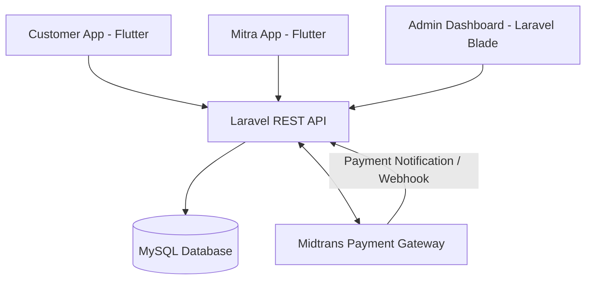
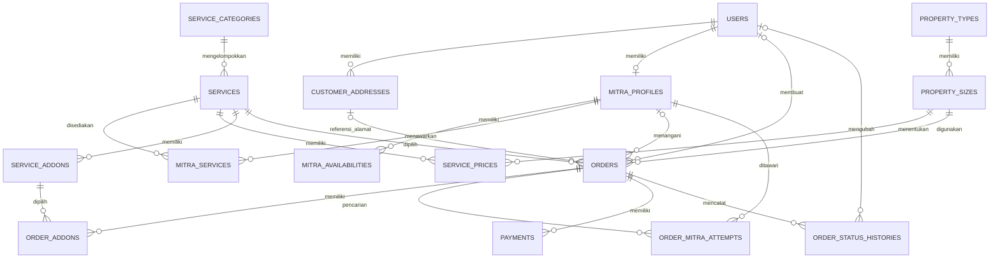

# Dokumentasi Sistem dan Struktur Database

## Aplikasi Marketplace Jasa Rumahan

**Status dokumen:** Rancangan awal yang telah disepakati kelompok  
**Database:** MySQL  
**Backend:** Laravel REST API  
**Aplikasi mobile:** Flutter (Customer dan Mitra)  
**Admin dashboard:** Laravel Blade

---

## Catatan status implementasi (14 Nov 2026)

Dokumen ini tetap menjadi rancangan domain dan struktur database kelompok. Status implementasi terbaru perlu dibaca bersama `docs/PROGRESS.md`, `docs/API_CONTRACT.md`, dan `docs/DECISIONS.md`. Pemilik proyek menetapkan ZIP sebagai versi baru dan GitHub sebagai versi lama; ChatGPT kini menjadi AI utama untuk pengerjaan Backend Laravel. Scope saat ini backend saja—Flutter tidak disentuh.

Berdasarkan output `php artisan test` yang diberikan pemilik pada 14 Nov 2026, suite backend berisi 135 tests: 100 passed dan 35 failed (768 assertions). Kegagalan yang teramati mencakup alias middleware Admin, redirect login Admin, akses jasa pada kategori nonaktif, HTTP 500 pada endpoint jasa mitra, serta expiry dan auto-complete pesanan. Ini catatan kondisi implementasi, bukan perubahan rancangan bisnis. Rincian dan urutan pemulihan dicatat di `PROGRESS.md`.

File Python yang disebut ada di ZIP adalah artefak eksperimen/test Qwenn yang belum diketahui fungsinya; tidak diasumsikan bagian dari sistem marketplace.

---

## Daftar Isi

1. [Gambaran Umum Sistem](#1-gambaran-umum-sistem)
2. [Teknologi yang Digunakan](#2-teknologi-yang-digunakan)
3. [Role dan Hak Akses](#3-role-dan-hak-akses)
4. [Konsep Mitra dan Jasa](#4-konsep-mitra-dan-jasa)
5. [Aturan Bisnis Pemesanan](#5-aturan-bisnis-pemesanan)
6. [Desain Customer App](#6-desain-customer-app)
7. [Desain Mitra App](#7-desain-mitra-app)
8. [Desain Admin Dashboard](#8-desain-admin-dashboard)
9. [Harga, Jadwal, dan Pencarian Mitra](#9-harga-jadwal-dan-pencarian-mitra)
10. [Pembayaran dan Penyelesaian Pesanan](#10-pembayaran-dan-penyelesaian-pesanan)
11. [Status Pesanan dan Status Pembayaran](#11-status-pesanan-dan-status-pembayaran)
12. [Arsitektur dan Alur Data Sistem](#12-arsitektur-dan-alur-data-sistem)
13. [Rancangan Struktur Database](#13-rancangan-struktur-database)
14. [Relasi Antar Tabel dan ERD](#14-relasi-antar-tabel-dan-erd)
15. [Aturan Teknis Database](#15-aturan-teknis-database)
16. [Batasan MVP dan Pengembangan Berikutnya](#16-batasan-mvp-dan-pengembangan-berikutnya)
17. [Prioritas Implementasi](#17-prioritas-implementasi)
18. [Keputusan Sistem yang Telah Disepakati](#18-keputusan-sistem-yang-telah-disepakati)

---

## 1. Gambaran Umum Sistem

Aplikasi ini merupakan **marketplace jasa rumahan** yang menghubungkan customer dengan mitra penyedia layanan rumah tangga. Customer dapat memilih jasa, menentukan ukuran properti, menambahkan layanan tambahan, memilih jadwal, lalu membuat pesanan. Sistem akan mencarikan mitra yang menyediakan jasa tersebut.

Contoh jasa utama:

- Home Cleaning (pembersihan rumah).
- Lawn Mowing (pemotongan rumput).
- Tree Trimming (pemangkasan pohon).
- Jasa perawatan dan perbaikan rumah lainnya.

Aplikasi memiliki tiga bagian utama:

1. **Customer App:** aplikasi mobile untuk customer.
2. **Mitra App:** aplikasi mobile untuk mitra penyedia jasa.
3. **Admin Dashboard:** dashboard web untuk mengelola pengguna, mitra, jasa, harga, pesanan, dan transaksi.

Satu backend Laravel dan satu database MySQL digunakan bersama oleh kedua aplikasi mobile dan dashboard admin.

### Tujuan sistem

- Memudahkan customer menemukan dan memesan jasa rumahan.
- Memungkinkan mitra memilih jenis jasa yang ingin ditawarkan.
- Mencocokkan pesanan dengan mitra yang sesuai dan tersedia.
- Mengelola harga dan katalog jasa melalui admin.
- Menyimpan data pesanan, pembayaran, dan riwayat status secara terstruktur.

---

## 2. Teknologi yang Digunakan

| Komponen | Teknologi | Fungsi |
|---|---|---|
| Customer App | Flutter | Aplikasi mobile customer |
| Mitra App | Flutter | Aplikasi mobile mitra |
| Admin Dashboard | Laravel Blade | Dashboard pengelolaan sistem |
| Backend/API | Laravel | Logika bisnis dan REST API |
| Database | MySQL | Penyimpanan data sistem |
| Komunikasi API | REST API | Pertukaran data antara Flutter dan backend |
| HTTP Client | Dio | Mengirim request API dari Flutter |
| Payment Gateway | Midtrans | Memproses pembayaran customer |
| API Testing | Postman | Menguji endpoint API |

**Catatan implementasi:** Laravel Sanctum dapat digunakan untuk autentikasi token pada aplikasi mobile. Token dapat disimpan di Flutter menggunakan Shared Preferences atau penyimpanan aman yang sesuai. Dashboard Blade dapat menggunakan autentikasi web berbasis session.

---

## 3. Role dan Hak Akses

Sistem memiliki tiga role utama.

### 3.1 Customer

Customer dapat:

- Melihat halaman utama dan katalog jasa.
- Melihat detail jasa dan harga.
- Memilih ukuran properti dan add-on.
- Memilih tanggal serta slot waktu pengerjaan.
- Membuat pesanan sebagai guest atau pengguna terdaftar.
- Melakukan pembayaran melalui Midtrans.
- Melihat status dan riwayat pesanan sesuai jenis akunnya.
- Mengonfirmasi pekerjaan telah selesai.

### 3.2 Mitra

Mitra dapat:

- Mendaftar dan login.
- Melengkapi profil mitra.
- Memilih lebih dari satu jenis jasa yang ingin ditawarkan.
- Mengatur ketersediaan dan jadwal operasional.
- Melihat pesanan yang ditawarkan kepadanya.
- Menerima atau menolak pesanan.
- Memperbarui status perjalanan dan pengerjaan.
- Melihat riwayat pesanan yang pernah ditangani.

Mitra hanya boleh menerima pesanan dari jasa yang terdaftar pada profil layanannya dan sesuai dengan ketersediaan jadwal.

### 3.3 Admin

Admin dapat:

- Mengelola akun customer dan mitra.
- Mengelola kategori dan katalog jasa.
- Mengelola jenis serta ukuran properti.
- Mengatur harga jasa berdasarkan ukuran properti.
- Mengelola add-on dan harganya.
- Melihat dan memantau pesanan.
- Melihat transaksi dan status pembayaran.
- Mengelola status akun serta, apabila diaktifkan, verifikasi mitra.

---

## 4. Konsep Mitra dan Jasa

Konsep pemilihan layanan mitra mengadaptasi gagasan marketplace seperti Gojek: mitra dapat memilih layanan apa saja yang ingin disediakan. Sistem tidak menganggap semua mitra otomatis menyediakan seluruh jenis jasa.

Satu mitra dapat menyediakan banyak jasa, dan satu jasa dapat disediakan oleh banyak mitra. Relasi ini adalah **many-to-many** dan disimpan pada tabel penghubung `mitra_services`.

Contoh:

| Mitra | Jasa yang Disediakan |
|---|---|
| Mitra A | Home Cleaning, Lawn Mowing |
| Mitra B | Home Cleaning, Tree Trimming |
| Mitra C | Lawn Mowing, Tree Trimming, Home Cleaning |

Ketentuan:

- Mitra memilih jasa dari katalog yang disediakan sistem.
- Mitra hanya ditawari pesanan untuk jasa yang telah dipilihnya.
- Mitra dapat menonaktifkan jasa yang tidak lagi ingin ditawarkan.
- Tidak ada batas maksimal jumlah jasa yang dipilih mitra untuk MVP.
- Status verifikasi dan ketersediaan mitra tetap diperiksa sebelum pesanan ditawarkan.

---

## 5. Aturan Bisnis Pemesanan

Aturan utama pemesanan adalah:

> **1 Customer → Banyak Pesanan**  
> **1 Pesanan → 1 Jasa Utama → 1 Mitra**  
> **1 Mitra → Banyak Jasa**  
> **1 Jasa → Banyak Mitra**

### 5.1 Pesanan lebih dari satu jasa

Jika customer ingin memesan dua jasa utama, sistem membuat dua pesanan terpisah.

Contoh customer memesan Home Cleaning dan Lawn Mowing:

| Kode Pesanan | Customer | Jasa Utama | Mitra |
|---|---|---|---|
| #001 | Customer A | Home Cleaning | Mitra X |
| #002 | Customer A | Lawn Mowing | Mitra Y |

Dua pesanan tersebut dapat ditangani oleh dua mitra berbeda. Secara teori, mitra yang sama juga dapat menerima keduanya apabila menyediakan kedua jasa dan jadwalnya memungkinkan. Namun, setiap jasa tetap menjadi pesanan terpisah dengan status, jadwal, serta proses pembayaran masing-masing.

Untuk MVP, customer melakukan checkout untuk setiap jasa utama secara terpisah.

### 5.2 Jasa utama dan add-on

Add-on merupakan layanan tambahan yang masih menjadi bagian dari satu jasa utama, bukan jasa utama baru.

Contoh:

- Jasa utama: Home Cleaning.
- Add-on: Pembersihan sofa.
- Add-on: Pembersihan kulkas.

Semua pilihan tersebut masuk ke satu pesanan Home Cleaning dan ditangani satu mitra.

Jika customer memesan Home Cleaning sekaligus Lawn Mowing, sistem membuat dua pesanan.

### 5.3 Aturan kepemilikan pesanan

- Satu pesanan hanya memiliki satu customer, baik customer terdaftar maupun guest.
- Satu pesanan hanya memiliki satu jasa utama.
- Satu pesanan hanya ditangani maksimal satu mitra pada satu waktu.
- `mitra_id` pada pesanan dapat kosong selama sistem masih mencari mitra.
- Setelah mitra menerima pesanan, sistem menetapkan mitra tersebut pada pesanan.
- Satu mitra boleh menangani banyak pesanan selama jadwalnya tidak bentrok dan kapasitasnya memungkinkan.

---

## 6. Desain Customer App

### 6.1 Guest Customer

Customer dapat langsung masuk ke halaman utama tanpa diwajibkan login atau registrasi.

Guest dapat:

- Melihat halaman utama.
- Melihat katalog dan detail jasa.
- Memilih jasa dan add-on.
- Memilih jadwal.
- Mengisi nama, nomor telepon, dan alamat secara manual.
- Membuat pesanan.
- Melacak pesanan menggunakan kode pesanan dan nomor telepon.

Guest tidak memiliki akun dan tidak dapat mengakses riwayat akun seperti customer terdaftar. Data kontak dan alamat guest disimpan sebagai snapshot pada pesanan.

### 6.2 Registered Customer

Registrasi menggunakan:

- Nama lengkap.
- Nomor telepon.
- Alamat utama.
- Password dan konfirmasi password.

Login menggunakan nomor telepon dan password.

Ketika checkout:

- Nama, nomor telepon, dan alamat dapat diisi otomatis dari profil.
- Customer tetap dapat mengubah detail kontak atau alamat untuk pesanan tersebut.
- Perubahan alamat checkout tidak otomatis mengganti alamat utama pada profil.
- Untuk MVP, satu alamat utama cukup; struktur database dapat mendukung beberapa alamat di masa mendatang.

### 6.3 Alur pemesanan customer

1. Customer membuka aplikasi dan masuk ke halaman utama.
2. Customer memilih satu jasa utama.
3. Customer memilih jenis atau ukuran properti.
4. Customer memilih add-on jika diperlukan.
5. Customer memilih tanggal dan slot waktu.
6. Sistem menghitung harga jasa dan add-on.
7. Customer mengisi atau memeriksa nama, nomor telepon, serta alamat.
8. Customer memeriksa ringkasan pesanan.
9. Customer mengirim pesanan.
10. Sistem mencari mitra yang sesuai.
11. Mitra menerima pesanan.
12. Customer melakukan pembayaran melalui Midtrans.
13. Backend memverifikasi pembayaran.
14. Setelah pembayaran berhasil, mitra dapat berangkat ke lokasi.
15. Mitra mengerjakan pesanan dan menandai pekerjaan selesai.
16. Customer memeriksa hasil pekerjaan dan mengonfirmasi penyelesaian.

Untuk jasa utama lain, customer membuat pesanan baru dengan alur yang sama.

---

## 7. Desain Mitra App

Fitur utama Mitra App:

- Registrasi dan login.
- Melengkapi profil mitra.
- Memilih jasa yang ingin disediakan.
- Mengatur ketersediaan dan jadwal operasional.
- Melihat pesanan yang ditawarkan.
- Melihat detail jasa, jadwal, dan alamat customer.
- Menerima atau menolak pesanan.
- Mengubah status menjadi sedang menuju lokasi.
- Mengonfirmasi sudah tiba di lokasi.
- Memulai pengerjaan.
- Menandai pekerjaan selesai.
- Melihat riwayat pesanan.

Mitra tidak boleh memulai perjalanan atau pengerjaan berdasarkan pesanan yang belum memenuhi kondisi pembayaran berhasil, sesuai alur MVP yang disepakati. Backend menjadi sumber kebenaran status pembayaran; aplikasi tidak boleh hanya mengandalkan hasil redirect dari halaman pembayaran.

---

## 8. Desain Admin Dashboard

Admin Dashboard dibuat menggunakan Laravel Blade, bukan aplikasi Flutter ketiga.

Fitur yang direncanakan:

- Dashboard ringkasan.
- Manajemen akun customer.
- Manajemen akun mitra.
- Manajemen profil dan status mitra.
- Manajemen kategori jasa.
- Manajemen katalog jasa.
- Manajemen jenis dan ukuran properti.
- Manajemen harga jasa.
- Manajemen add-on dan harga add-on.
- Melihat daftar pesanan.
- Melihat transaksi dan status pembayaran.

Admin mengubah harga melalui dashboard. Perubahan harga tidak memerlukan perubahan kode program.

---

## 9. Harga, Jadwal, dan Pencarian Mitra

### 9.1 Sistem harga

Harga jasa ditentukan berdasarkan jasa utama dan ukuran properti melalui tabel `service_prices`.

Contoh ilustrasi:

| Jasa | Ukuran Properti | Harga |
|---|---|---:|
| Home Cleaning | Rumah Kecil | Rp100.000 |
| Home Cleaning | Rumah Sedang | Rp150.000 |
| Home Cleaning | Rumah Besar | Rp200.000 |

Harga add-on disimpan pada tabel `service_addons`.

Saat pesanan dibuat, harga jasa, harga add-on, dan total pembayaran disalin ke tabel transaksi sebagai snapshot. Dengan demikian, perubahan harga di kemudian hari tidak mengubah nilai pesanan lama.

### 9.2 Sistem jadwal

- Jam operasional layanan yang direncanakan: 08.00–20.00.
- Customer memilih tanggal dan slot waktu yang disediakan aplikasi.
- Customer tidak memasukkan waktu secara bebas.
- Sistem memeriksa jadwal operasional mitra dan pesanan aktif agar tidak terjadi bentrok.
- Interval slot dan aturan durasi perlu ditetapkan saat implementasi.

Keterangan pada halaman pemesanan:

> Estimasi pengerjaan paling lama 1–2 jam setelah mitra tiba di lokasi.

Keterangan tersebut merupakan estimasi, bukan jaminan. Durasi aktual dapat berbeda berdasarkan ukuran properti dan kombinasi layanan.

### 9.3 Pencarian mitra

Sistem mencari mitra berdasarkan beberapa kondisi:

1. Mitra memiliki jasa yang sesuai pada `mitra_services`.
2. Jasa yang ditawarkan mitra berstatus aktif.
3. Profil mitra memenuhi status yang disyaratkan sistem.
4. Mitra sedang tersedia.
5. Jadwal mitra sesuai dengan waktu pesanan.
6. Mitra tidak memiliki pesanan lain yang menyebabkan bentrok jadwal.

Alur pencarian:

1. Pesanan dibuat dengan status pencarian mitra.
2. Sistem menawarkan pesanan ke mitra yang memenuhi syarat.
3. Mitra menerima atau menolak.
4. Jika ditolak atau tidak merespons sampai batas waktu, sistem mencoba mitra lain.
5. Setiap percobaan dicatat pada `order_mitra_attempts`.
6. Jika tidak ada mitra yang menerima setelah batas percobaan, pesanan dibatalkan.

Penetapan mitra harus ditangani secara aman di backend agar dua mitra tidak sama-sama berhasil mengambil pesanan yang sama akibat request bersamaan.

---

## 10. Pembayaran dan Penyelesaian Pesanan

### 10.1 Pembayaran

Untuk MVP, pembayaran menggunakan Midtrans Payment Gateway. COD belum termasuk versi awal.

Alur pembayaran:

1. Customer membuat pesanan.
2. Sistem mencari mitra.
3. Mitra menerima pesanan.
4. Customer menerima opsi pembayaran melalui Midtrans.
5. Backend membuat transaksi dan menyimpan data pembayaran.
6. Customer menyelesaikan pembayaran.
7. Midtrans mengirim notifikasi/webhook ke backend.
8. Backend memverifikasi notifikasi dan memperbarui status pembayaran.
9. Jika pembayaran berhasil, mitra dapat berangkat ke lokasi.

**Penting:** Status pembayaran harus diverifikasi melalui notifikasi/webhook Midtrans di backend. Redirect kembali ke aplikasi saja tidak cukup sebagai bukti pembayaran berhasil.

### 10.2 Pembayaran bukan pencairan dana mitra

Midtrans memproses pembayaran customer kepada merchant/platform. Proses pencairan dana dari platform kepada mitra merupakan proses terpisah.

Untuk MVP:

- Sistem mencatat pembayaran customer.
- Sistem mencatat status penyelesaian pesanan.
- Saldo mitra dan pencairan dana otomatis belum dibuat.
- Pencairan kepada mitra dapat dikelola terpisah terlebih dahulu.

Jangan mengasumsikan dana otomatis diteruskan kepada mitra saat customer menekan tombol konfirmasi selesai.

### 10.3 Pembatalan dan pengembalian dana

- Jika pesanan belum dibayar, pesanan dapat dibatalkan tanpa refund.
- Jika pembayaran sudah berhasil lalu pesanan dibatalkan, sistem mengajukan refund sesuai dukungan metode pembayaran dan ketentuan Midtrans.
- Status refund dicatat pada data pembayaran.
- Jika refund otomatis tidak tersedia atau gagal, admin menangani proses lanjutan secara manual.

Dukungan refund dan waktu proses dapat berbeda menurut metode pembayaran; jangan menganggap semua metode mendukung refund instan.

### 10.4 Konfirmasi penyelesaian pekerjaan

1. Mitra menekan tombol **Tugas Selesai**.
2. Status pesanan menjadi menunggu konfirmasi customer atau `mitra_completed`.
3. Customer memeriksa hasil pekerjaan.
4. Customer menekan tombol **Konfirmasi Selesai**.
5. Sistem mengubah status pesanan menjadi `completed`.

Pesanan tidak langsung dianggap selesai hanya karena mitra menekan tombol penyelesaian.

---

## 11. Status Pesanan dan Status Pembayaran

Status pesanan dan status pembayaran merupakan dua hal berbeda dan harus disimpan terpisah.

### 11.1 Status pesanan

Status internal yang direncanakan:

| Status | Arti |
|---|---|
| `pending` | Pesanan baru dibuat |
| `searching_mitra` | Sistem sedang mencari mitra |
| `waiting_payment` | Mitra menerima pesanan dan customer perlu membayar |
| `confirmed` | Pembayaran berhasil dan pesanan dikonfirmasi |
| `on_the_way` | Mitra sedang menuju lokasi |
| `arrived` | Mitra sudah tiba di lokasi |
| `in_progress` | Pengerjaan sedang berlangsung |
| `mitra_completed` | Mitra menandai pekerjaan selesai |
| `completed` | Customer telah mengonfirmasi pekerjaan selesai |
| `cancelled` | Pesanan dibatalkan |

Nama status dapat disesuaikan saat implementasi, tetapi alur bisnisnya harus tetap konsisten.

### 11.2 Tampilan tracking customer

Customer melihat tiga tahap utama:

1. **Pesanan Dikonfirmasi:** mitra menerima pesanan dan pembayaran berhasil.
2. **Pengerjaan:** mitra menuju lokasi, tiba, dan mulai bekerja.
3. **Selesai:** mitra menandai pekerjaan selesai dan customer mengonfirmasi.

Status internal yang lebih rinci tetap disimpan di database.

### 11.3 Status pembayaran

Status pembayaran yang direncanakan:

- `pending`
- `paid`
- `failed`
- `expired`
- `refund_pending`
- `refunded`
- `refund_failed`

Status pembayaran disimpan pada tabel `payments`, bukan digabung ke `orders.order_status`.

---

## 12. Arsitektur dan Alur Data Sistem

### 12.1 Arsitektur umum

Customer App dan Mitra App berkomunikasi dengan backend Laravel melalui REST API menggunakan Dio. Laravel mengakses MySQL untuk membaca dan menyimpan data. Admin menggunakan dashboard Laravel Blade. Backend berkomunikasi dengan Midtrans untuk transaksi dan menerima notifikasi pembayaran.

### 12.2 Alur data pembuatan pesanan

1. Aplikasi mengirim data pesanan ke REST API.
2. Backend memvalidasi jasa, ukuran properti, add-on, harga, alamat, dan jadwal.
3. Backend menghitung ulang total harga; jangan hanya mempercayai total yang dikirim aplikasi.
4. Backend menyimpan pesanan pada `orders`.
5. Backend menyimpan add-on pada `order_addons`.
6. Backend mencari mitra melalui `mitra_services` dan memeriksa ketersediaan.
7. Backend mencatat penawaran mitra pada `order_mitra_attempts`.
8. Setelah mitra menerima, backend menetapkan `orders.mitra_id`.
9. Backend membuat transaksi Midtrans dan menyimpan data pada `payments`.
10. Backend memperbarui status berdasarkan notifikasi pembayaran.
11. Perubahan status pesanan dicatat pada `order_status_histories`.

### 12.3 Contoh kelompok endpoint API

Daftar berikut merupakan kelompok endpoint yang dapat dikembangkan; bukan daftar endpoint final.

| Kelompok | Contoh fungsi |
|---|---|
| Authentication | Register, login, logout, profil |
| Services | Daftar jasa, detail jasa, kategori, harga, add-on |
| Customer | Alamat, profil, riwayat pesanan |
| Mitra | Profil, jasa yang ditawarkan, ketersediaan, pesanan masuk |
| Orders | Buat pesanan, detail, daftar, pembatalan, tracking |
| Payments | Membuat transaksi, memeriksa pembayaran, webhook Midtrans |
| Admin | CRUD pengguna, mitra, jasa, harga, pesanan, transaksi |

---

## 13. Rancangan Struktur Database

Database dirancang dengan **16 tabel**. Nama tabel menggunakan istilah `mitra`, bukan `provider`, agar konsisten dengan istilah di aplikasi.

### Konvensi umum

- Seluruh primary key menggunakan `BIGINT UNSIGNED AUTO_INCREMENT`.
- Foreign key menggunakan tipe data yang sama dengan primary key tujuan.
- Kolom waktu umum menggunakan `created_at` dan `updated_at`.
- Kolom status dapat disimpan sebagai `VARCHAR` dan divalidasi di aplikasi/backend agar penambahan status lebih mudah.
- `NULL` hanya digunakan jika memang ada kondisi bisnis yang memperbolehkannya.

### A. Tabel pengguna dan mitra

#### 1. `users` — data akun pengguna

Menyimpan akun Customer, Mitra, dan Admin.

| Kolom | Tipe Data | Key / Constraint | Keterangan |
|---|---|---|---|
| `id` | BIGINT UNSIGNED | PK | ID akun |
| `full_name` | VARCHAR(100) | NOT NULL | Nama lengkap |
| `phone` | VARCHAR(20) | UNIQUE, NOT NULL | Nomor telepon |
| `email` | VARCHAR(100) | UNIQUE, NULL | Email jika tersedia |
| `password` | VARCHAR(255) | NOT NULL | Password hash |
| `role` | VARCHAR(20) | NOT NULL | `customer`, `mitra`, atau `admin` |
| `account_status` | VARCHAR(20) | NOT NULL | `active`, `inactive`, `suspended` |
| `created_at` | TIMESTAMP |  | Waktu dibuat |
| `updated_at` | TIMESTAMP |  | Waktu diperbarui |

Catatan: Guest tidak dibuatkan akun di tabel `users`.

#### 2. `customer_addresses` — alamat customer

Menyimpan alamat customer terdaftar. Untuk MVP satu alamat utama sudah cukup, tetapi tabel memungkinkan pengembangan beberapa alamat.

| Kolom | Tipe Data | Key / Constraint | Keterangan |
|---|---|---|---|
| `id` | BIGINT UNSIGNED | PK | ID alamat |
| `customer_id` | BIGINT UNSIGNED | FK → `users.id` | Pemilik alamat |
| `address_label` | VARCHAR(50) | NOT NULL | Contoh: Rumah |
| `recipient_name` | VARCHAR(100) | NOT NULL | Nama penerima |
| `recipient_phone` | VARCHAR(20) | NOT NULL | Nomor penerima |
| `full_address` | TEXT | NOT NULL | Alamat lengkap |
| `city` | VARCHAR(100) | NULL | Kota |
| `province` | VARCHAR(100) | NULL | Provinsi |
| `postal_code` | VARCHAR(10) | NULL | Kode pos |
| `is_primary` | BOOLEAN | DEFAULT FALSE | Penanda alamat utama |
| `created_at` | TIMESTAMP |  | Waktu dibuat |
| `updated_at` | TIMESTAMP |  | Waktu diperbarui |

#### 3. `mitra_profiles` — profil mitra

Menyimpan informasi khusus mitra yang terhubung dengan akun pada `users`.

| Kolom | Tipe Data | Key / Constraint | Keterangan |
|---|---|---|---|
| `id` | BIGINT UNSIGNED | PK | ID profil mitra |
| `user_id` | BIGINT UNSIGNED | FK → `users.id`, UNIQUE | Akun pemilik profil |
| `bio` | TEXT | NULL | Deskripsi mitra |
| `service_area` | VARCHAR(255) | NULL | Wilayah layanan |
| `verification_status` | VARCHAR(20) | NOT NULL | `pending`, `approved`, `rejected` |
| `is_available` | BOOLEAN | DEFAULT TRUE | Ketersediaan menerima pesanan |
| `created_at` | TIMESTAMP |  | Waktu dibuat |
| `updated_at` | TIMESTAMP |  | Waktu diperbarui |

#### 4. `mitra_availabilities` — jadwal operasional mitra

Menyimpan hari dan jam operasional mitra.

| Kolom | Tipe Data | Key / Constraint | Keterangan |
|---|---|---|---|
| `id` | BIGINT UNSIGNED | PK | ID jadwal |
| `mitra_id` | BIGINT UNSIGNED | FK → `mitra_profiles.id` | Mitra pemilik jadwal |
| `day_of_week` | TINYINT UNSIGNED | NOT NULL | Hari operasional, misalnya 0–6 |
| `start_time` | TIME | NOT NULL | Jam mulai |
| `end_time` | TIME | NOT NULL | Jam selesai |
| `is_active` | BOOLEAN | DEFAULT TRUE | Status jadwal |

### B. Tabel jasa dan harga

#### 5. `service_categories` — kategori jasa

Menyimpan kategori utama jasa.

| Kolom | Tipe Data | Key / Constraint | Keterangan |
|---|---|---|---|
| `id` | BIGINT UNSIGNED | PK | ID kategori |
| `category_name` | VARCHAR(100) | NOT NULL | Nama kategori |
| `description` | TEXT | NULL | Deskripsi kategori |
| `is_active` | BOOLEAN | DEFAULT TRUE | Status kategori |

Contoh: Kebersihan Rumah, Perawatan Taman, Perawatan Pohon.

#### 6. `services` — daftar jasa utama

Menyimpan katalog jasa yang dapat dipesan customer.

| Kolom | Tipe Data | Key / Constraint | Keterangan |
|---|---|---|---|
| `id` | BIGINT UNSIGNED | PK | ID jasa |
| `category_id` | BIGINT UNSIGNED | FK → `service_categories.id` | Kategori jasa |
| `service_name` | VARCHAR(100) | NOT NULL | Nama jasa |
| `description` | TEXT | NULL | Deskripsi jasa |
| `duration_minutes` | INT UNSIGNED | NULL | Estimasi durasi |
| `is_active` | BOOLEAN | DEFAULT TRUE | Status jasa |
| `created_at` | TIMESTAMP |  | Waktu dibuat |
| `updated_at` | TIMESTAMP |  | Waktu diperbarui |

Contoh: Home Cleaning, Lawn Mowing, Tree Trimming.

#### 7. `mitra_services` — relasi mitra dan jasa

Tabel penghubung many-to-many antara `mitra_profiles` dan `services`.

| Kolom | Tipe Data | Key / Constraint | Keterangan |
|---|---|---|---|
| `id` | BIGINT UNSIGNED | PK | ID relasi |
| `mitra_id` | BIGINT UNSIGNED | FK → `mitra_profiles.id` | Mitra |
| `service_id` | BIGINT UNSIGNED | FK → `services.id` | Jasa yang disediakan |
| `status` | VARCHAR(20) | NOT NULL | `active` atau `inactive` |
| `created_at` | TIMESTAMP |  | Waktu ditambahkan |

**Constraint penting:** pasangan `mitra_id` dan `service_id` harus UNIQUE agar mitra tidak mendaftarkan jasa yang sama berkali-kali.

#### 8. `property_types` — jenis properti

Menyimpan pilihan jenis properti customer.

| Kolom | Tipe Data | Key / Constraint | Keterangan |
|---|---|---|---|
| `id` | BIGINT UNSIGNED | PK | ID jenis properti |
| `type_name` | VARCHAR(100) | NOT NULL | Contoh: Rumah, Apartemen, Kantor |
| `is_active` | BOOLEAN | DEFAULT TRUE | Status |

#### 9. `property_sizes` — ukuran properti

Menyimpan pilihan ukuran berdasarkan jenis properti.

| Kolom | Tipe Data | Key / Constraint | Keterangan |
|---|---|---|---|
| `id` | BIGINT UNSIGNED | PK | ID ukuran |
| `property_type_id` | BIGINT UNSIGNED | FK → `property_types.id` | Jenis properti |
| `size_name` | VARCHAR(100) | NOT NULL | Nama ukuran |
| `min_area` | DECIMAL(10,2) | NULL | Luas minimum dalam m² |
| `max_area` | DECIMAL(10,2) | NULL | Luas maksimum dalam m² |
| `is_active` | BOOLEAN | DEFAULT TRUE | Status |

#### 10. `service_prices` — harga jasa

Menyimpan harga jasa berdasarkan ukuran properti.

| Kolom | Tipe Data | Key / Constraint | Keterangan |
|---|---|---|---|
| `id` | BIGINT UNSIGNED | PK | ID harga |
| `service_id` | BIGINT UNSIGNED | FK → `services.id` | Jasa |
| `property_size_id` | BIGINT UNSIGNED | FK → `property_sizes.id` | Ukuran properti |
| `price` | DECIMAL(12,2) | NOT NULL | Harga jasa |
| `is_active` | BOOLEAN | DEFAULT TRUE | Status harga |
| `created_at` | TIMESTAMP |  | Waktu dibuat |
| `updated_at` | TIMESTAMP |  | Waktu diperbarui |

**Constraint penting:** pasangan `service_id` dan `property_size_id` dibuat UNIQUE agar satu kombinasi jasa dan ukuran memiliki satu harga aktif. Ketika admin mengubah harga, baris harga dapat diperbarui; harga transaksi lama tetap aman karena nilainya sudah disalin sebagai snapshot ke tabel `orders`. Jika kelompok ingin menyimpan seluruh histori perubahan harga master, histori tersebut dapat ditambahkan pada pengembangan berikutnya.

#### 11. `service_addons` — jasa tambahan

Menyimpan add-on yang hanya dapat dipilih untuk jasa utama tertentu.

| Kolom | Tipe Data | Key / Constraint | Keterangan |
|---|---|---|---|
| `id` | BIGINT UNSIGNED | PK | ID add-on |
| `service_id` | BIGINT UNSIGNED | FK → `services.id` | Jasa utama terkait |
| `addon_name` | VARCHAR(100) | NOT NULL | Nama add-on |
| `description` | TEXT | NULL | Deskripsi |
| `price` | DECIMAL(12,2) | NOT NULL | Harga add-on |
| `is_active` | BOOLEAN | DEFAULT TRUE | Status add-on |

Contoh add-on Home Cleaning: Pembersihan Sofa dan Pembersihan Kulkas.

### C. Tabel pemesanan

#### 12. `orders` — data pesanan

Tabel inti yang menyimpan setiap pesanan customer.

| Kolom | Tipe Data | Key / Constraint | Keterangan |
|---|---|---|---|
| `id` | BIGINT UNSIGNED | PK | ID pesanan |
| `order_code` | VARCHAR(30) | UNIQUE, NOT NULL | Kode pesanan yang dapat digunakan untuk tracking guest |
| `customer_id` | BIGINT UNSIGNED | FK → `users.id`, NULL | Customer terdaftar; NULL untuk guest |
| `customer_address_id` | BIGINT UNSIGNED | FK → `customer_addresses.id`, NULL | Referensi alamat tersimpan jika digunakan |
| `mitra_id` | BIGINT UNSIGNED | FK → `mitra_profiles.id`, NULL | Mitra yang ditetapkan; NULL saat pencarian |
| `service_id` | BIGINT UNSIGNED | FK → `services.id` | Satu jasa utama |
| `property_size_id` | BIGINT UNSIGNED | FK → `property_sizes.id` | Ukuran properti |
| `scheduled_at` | DATETIME | NOT NULL | Jadwal pengerjaan |
| `duration_minutes` | INT UNSIGNED | NULL | Snapshot estimasi durasi |
| `customer_name` | VARCHAR(100) | NOT NULL | Snapshot nama customer |
| `customer_phone` | VARCHAR(20) | NOT NULL | Snapshot nomor telepon |
| `service_address` | TEXT | NOT NULL | Snapshot alamat pengerjaan |
| `address_notes` | TEXT | NULL | Catatan alamat |
| `service_price` | DECIMAL(12,2) | NOT NULL | Snapshot harga jasa |
| `addons_total` | DECIMAL(12,2) | NOT NULL | Total snapshot add-on |
| `total_price` | DECIMAL(12,2) | NOT NULL | Total harga pesanan |
| `order_status` | VARCHAR(30) | NOT NULL | Status siklus pesanan |
| `customer_note` | TEXT | NULL | Catatan customer |
| `created_at` | TIMESTAMP |  | Waktu dibuat |
| `updated_at` | TIMESTAMP |  | Waktu diperbarui |

Catatan:

- `customer_id` boleh NULL untuk guest.
- `customer_address_id` boleh NULL jika guest mengisi alamat manual atau customer mengubah alamat khusus pesanan.
- `mitra_id` boleh NULL ketika sistem masih mencari mitra.
- `customer_name`, `customer_phone`, `service_address`, dan nilai harga adalah snapshot agar detail pesanan lama tidak berubah saat profil atau harga master diubah.
- `order_code` harus unik, acak, dan tidak mudah ditebak. Untuk tracking guest, sistem memeriksa kombinasi kode pesanan dan nomor telepon serta menerapkan pembatasan percobaan.

#### 13. `order_addons` — detail add-on pesanan

Menghubungkan pesanan dengan add-on pilihan customer.

| Kolom | Tipe Data | Key / Constraint | Keterangan |
|---|---|---|---|
| `id` | BIGINT UNSIGNED | PK | ID detail add-on |
| `order_id` | BIGINT UNSIGNED | FK → `orders.id` | Pesanan |
| `service_addon_id` | BIGINT UNSIGNED | FK → `service_addons.id` | Add-on dari katalog |
| `addon_name` | VARCHAR(100) | NOT NULL | Snapshot nama add-on |
| `unit_price` | DECIMAL(12,2) | NOT NULL | Snapshot harga satuan |
| `quantity` | INT UNSIGNED | DEFAULT 1 | Jumlah |
| `subtotal` | DECIMAL(12,2) | NOT NULL | Snapshot subtotal |

Nama dan harga add-on disalin ke tabel ini agar perubahan katalog tidak mengubah rincian pesanan lama.

#### 14. `order_mitra_attempts` — riwayat pencarian mitra

Mencatat mitra yang ditawari setiap pesanan.

| Kolom | Tipe Data | Key / Constraint | Keterangan |
|---|---|---|---|
| `id` | BIGINT UNSIGNED | PK | ID percobaan |
| `order_id` | BIGINT UNSIGNED | FK → `orders.id` | Pesanan |
| `mitra_id` | BIGINT UNSIGNED | FK → `mitra_profiles.id` | Mitra yang ditawari |
| `attempt_number` | INT UNSIGNED | NOT NULL | Urutan percobaan |
| `status` | VARCHAR(20) | NOT NULL | `offered`, `accepted`, `rejected`, `expired` |
| `offered_at` | DATETIME | NOT NULL | Waktu penawaran |
| `responded_at` | DATETIME | NULL | Waktu respons |

Constraint yang disarankan:

- UNIQUE (`order_id`, `mitra_id`) agar mitra yang sama tidak ditawari berulang dalam satu proses pencarian.
- UNIQUE (`order_id`, `attempt_number`) agar nomor percobaan tidak duplikat.

### D. Tabel pembayaran dan riwayat status

#### 15. `payments` — data pembayaran

Menyimpan transaksi pembayaran customer melalui Midtrans.

| Kolom | Tipe Data | Key / Constraint | Keterangan |
|---|---|---|---|
| `id` | BIGINT UNSIGNED | PK | ID pembayaran |
| `order_id` | BIGINT UNSIGNED | FK → `orders.id` | Pesanan terkait |
| `gateway` | VARCHAR(30) | NOT NULL | Nama payment gateway, yaitu Midtrans |
| `gateway_order_id` | VARCHAR(100) | UNIQUE, NOT NULL | ID transaksi yang dibuat sistem untuk gateway |
| `transaction_id` | VARCHAR(100) | NULL | ID transaksi dari Midtrans |
| `snap_token` | TEXT | NULL | Token transaksi Snap |
| `amount` | DECIMAL(12,2) | NOT NULL | Nominal pembayaran |
| `payment_method` | VARCHAR(50) | NULL | Metode pembayaran |
| `payment_status` | VARCHAR(30) | NOT NULL | Status pembayaran/refund |
| `paid_at` | DATETIME | NULL | Waktu pembayaran berhasil |
| `expired_at` | DATETIME | NULL | Waktu kedaluwarsa |
| `created_at` | TIMESTAMP |  | Waktu dibuat |
| `updated_at` | TIMESTAMP |  | Waktu diperbarui |

Status pembayaran yang direncanakan:

- `pending`
- `paid`
- `failed`
- `expired`
- `refund_pending`
- `refunded`
- `refund_failed`

Satu pesanan dapat memiliki beberapa percobaan pembayaran. Status transaksi harus diperbarui secara idempotent berdasarkan notifikasi gateway agar notifikasi yang dikirim berulang tidak menggandakan proses.

#### 16. `order_status_histories` — riwayat status pesanan

Mencatat perubahan status pesanan.

| Kolom | Tipe Data | Key / Constraint | Keterangan |
|---|---|---|---|
| `id` | BIGINT UNSIGNED | PK | ID riwayat |
| `order_id` | BIGINT UNSIGNED | FK → `orders.id` | Pesanan terkait |
| `changed_by_user_id` | BIGINT UNSIGNED | FK → `users.id`, NULL | Pengguna yang melakukan perubahan; NULL jika sistem |
| `old_status` | VARCHAR(30) | NULL | Status sebelumnya |
| `new_status` | VARCHAR(30) | NOT NULL | Status baru |
| `note` | TEXT | NULL | Keterangan perubahan |
| `created_at` | TIMESTAMP |  | Waktu perubahan |

---

## 14. Relasi Antar Tabel dan ERD

### 14.1 Ringkasan relasi

| No. | Relasi | Jenis |
|---|---|---|
| 1 | `users` → `customer_addresses` | One-to-Many |
| 2 | `users` → `mitra_profiles` | One-to-One (opsional untuk setiap akun) |
| 3 | `mitra_profiles` → `mitra_availabilities` | One-to-Many |
| 4 | `service_categories` → `services` | One-to-Many |
| 5 | `mitra_profiles` ↔ `services` melalui `mitra_services` | Many-to-Many |
| 6 | `property_types` → `property_sizes` | One-to-Many |
| 7 | `services` → `service_prices` | One-to-Many |
| 8 | `property_sizes` → `service_prices` | One-to-Many |
| 9 | `services` → `service_addons` | One-to-Many |
| 10 | `users` → `orders` | One-to-Many; `customer_id` dapat NULL untuk guest |
| 11 | `customer_addresses` → `orders` | One-to-Many secara referensi; FK pada order dapat NULL |
| 12 | `mitra_profiles` → `orders` | One-to-Many; `mitra_id` dapat NULL sebelum penugasan |
| 13 | `services` → `orders` | One-to-Many |
| 14 | `property_sizes` → `orders` | One-to-Many |
| 15 | `orders` → `order_addons` | One-to-Many |
| 16 | `orders` → `order_mitra_attempts` | One-to-Many |
| 17 | `mitra_profiles` → `order_mitra_attempts` | One-to-Many |
| 18 | `orders` → `payments` | One-to-Many |
| 19 | `orders` → `order_status_histories` | One-to-Many |
| 20 | `users` → `order_status_histories` | One-to-Many; pelaku perubahan dapat NULL jika sistem |

### 14.2 ERD Mermaid

**Catatan ERD:** Relasi `users` ke `orders` bersifat opsional pada sisi order karena guest tidak memiliki `customer_id`. Relasi `mitra_profiles` ke `orders` juga opsional sebelum mitra ditemukan dan ditetapkan. Satu order tetap hanya menyimpan satu `mitra_id` final.

---

## 15. Aturan Teknis Database

1. **Primary key dan foreign key:** semua relasi harus menggunakan tipe data yang konsisten.
2. **Nominal uang:** gunakan `DECIMAL(12,2)`, bukan `FLOAT` atau `DOUBLE`.
3. **Password:** simpan menggunakan hashing Laravel, bukan teks biasa.
4. **Nomor telepon:** simpan sebagai string agar angka nol di depan tidak hilang.
5. **Data snapshot:** simpan nama, telepon, alamat, nama add-on, harga, dan total pada pesanan agar transaksi lama tetap konsisten.
6. **Soft delete/nonaktif:** jasa, kategori, add-on, ukuran properti, dan akun yang sudah dipakai transaksi sebaiknya dinonaktifkan, bukan dihapus permanen.
7. **Status terpisah:** `orders.order_status` berbeda dari `payments.payment_status`.
8. **Kode pesanan:** gunakan kode unik yang tidak mudah ditebak; guest tracking memeriksa kode pesanan dan nomor telepon.
9. **Validasi harga:** backend menghitung ulang harga dari database. Jangan mempercayai nominal yang dikirim langsung oleh aplikasi Flutter.
10. **Validasi jadwal:** backend memeriksa jadwal operasional dan pesanan aktif untuk mencegah bentrok.
11. **Penetapan mitra:** gunakan transaksi database atau mekanisme penguncian yang sesuai agar satu pesanan tidak diambil dua mitra secara bersamaan.
12. **Webhook pembayaran:** verifikasi notifikasi Midtrans di backend dan tangani notifikasi berulang secara aman.
13. **Penghapusan data:** hindari penghapusan berantai pada data transaksi dan riwayat. Data master yang sudah dipakai sebaiknya dipertahankan.
14. **Indeks:** tambahkan indeks pada foreign key dan kolom yang sering dicari, seperti `order_code`, `phone`, `order_status`, `payment_status`, `service_id`, dan `mitra_id`.

---

## 16. Batasan MVP dan Pengembangan Berikutnya

### 16.1 Fitur yang menjadi fokus MVP

- Customer dapat masuk sebagai guest tanpa login paksa.
- Registrasi dan login customer.
- Registrasi dan login mitra.
- Katalog jasa dan detail harga.
- Mitra memilih jasa yang ingin disediakan.
- Pemilihan jenis/ukuran properti.
- Add-on untuk jasa utama tertentu.
- Pemesanan satu jasa utama per pesanan.
- Pencarian mitra dengan batas percobaan.
- Pengaturan jadwal dasar dan pengecekan bentrok.
- Pembayaran Midtrans.
- Tracking status pesanan.
- Konfirmasi penyelesaian oleh customer.
- Admin mengelola akun, katalog, harga, pesanan, dan transaksi.

### 16.2 Fitur yang belum masuk MVP

**Prioritas pengembangan tinggi:**

- Pembayaran COD.
- Pelaporan masalah atau komplain.
- Rating dan ulasan.
- Verifikasi mitra yang lebih lengkap.

**Prioritas menengah:**

- Saldo mitra dan pencairan dana otomatis.
- Push notification.
- Live chat.
- Penanganan pembatalan yang lebih lengkap.

**Prioritas rendah:**

- Live GPS tracking.
- Voucher dan promosi.
- Loyalty program.

Fitur-fitur tersebut dapat dimasukkan ke backlog setelah alur utama aplikasi berjalan.

---

## 17. Prioritas Implementasi

Urutan implementasi yang disarankan:

| Tahap | Tabel | Fokus |
|---|---|---|
| 1 | `users`, `customer_addresses`, `mitra_profiles` | Akun dan profil |
| 2 | `service_categories`, `services`, `mitra_services` | Katalog dan jasa mitra |
| 3 | `property_types`, `property_sizes`, `service_prices`, `service_addons` | Harga dan add-on |
| 4 | `orders`, `order_addons` | Pemesanan |
| 5 | `mitra_availabilities`, `order_mitra_attempts` | Jadwal dan pencarian mitra |
| 6 | `payments`, `order_status_histories` | Pembayaran dan tracking |

Walaupun tabel sudah dirancang lengkap, implementasi dapat dilakukan bertahap. Pastikan kelompok menyelesaikan alur inti terlebih dahulu sebelum mengerjakan fitur backlog.

---

## 18. Keputusan Sistem yang Telah Disepakati

Ringkasan keputusan final rancangan awal:

| No. | Keputusan | Status |
|---|---|---|
| 1 | Customer dapat membuka aplikasi tanpa login paksa | Disepakati |
| 2 | Guest dapat membuat pesanan dan tracking dengan kode pesanan serta nomor telepon | Disepakati |
| 3 | Customer terdaftar dapat menggunakan data profil saat checkout | Disepakati |
| 4 | Alamat checkout dapat diubah tanpa mengubah alamat utama profil | Disepakati |
| 5 | Satu mitra dapat menyediakan banyak jasa | Disepakati |
| 6 | Satu jasa dapat disediakan banyak mitra | Disepakati |
| 7 | Satu pesanan hanya memiliki satu jasa utama | Disepakati |
| 8 | Satu pesanan hanya ditangani satu mitra | Disepakati |
| 9 | Beberapa jasa utama yang dipesan customer menjadi beberapa pesanan terpisah | Disepakati |
| 10 | Add-on tetap menjadi bagian dari pesanan jasa utama | Disepakati |
| 11 | Harga dikelola melalui Admin Dashboard | Disepakati |
| 12 | Sistem mencari mitra yang sesuai dan mencoba mitra lain jika ditolak/tidak merespons | Disepakati |
| 13 | Jika tidak ada mitra yang menerima setelah batas percobaan, pesanan dibatalkan | Disepakati |
| 14 | Pembayaran MVP menggunakan Midtrans | Disepakati |
| 15 | Status pesanan dan pembayaran dipisahkan | Disepakati |
| 16 | Penyelesaian pesanan membutuhkan tindakan mitra dan konfirmasi customer | Disepakati |
| 17 | Pencairan dana otomatis kepada mitra belum termasuk MVP | Disepakati |
| 18 | Penamaan tabel menggunakan `mitra`, bukan `provider` | Disepakati |

### Kesimpulan

Sistem dirancang sebagai marketplace jasa rumahan dengan tiga role: Customer, Mitra, dan Admin. Customer dapat memesan beberapa jasa, tetapi setiap jasa utama diproses sebagai pesanan tersendiri dan ditangani satu mitra. Mitra dapat memilih banyak jasa yang ingin ditawarkan. Laravel menjadi backend dan pengelola dashboard, Flutter menjadi aplikasi mobile, sedangkan MySQL menyimpan seluruh data sistem.

Rancangan ini menjadi dasar pembuatan ERD final, Laravel migration, REST API, dan implementasi aplikasi. Detail teknis seperti interval slot, batas percobaan pencarian mitra, waktu respons mitra, serta aturan refund perlu ditetapkan sebelum fitur terkait diimplementasikan.
